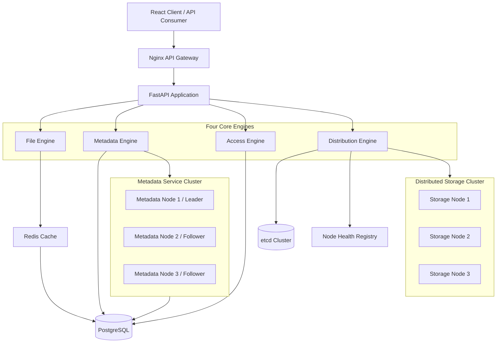

# Phase 1 Architecture

## Logical layers

## Engine boundaries

| Engine | Owns | Reads/Writes |
|---|---|---|
| File Engine | Upload validation, SHA-256, versions, integrity | Object storage and metadata operations |
| Metadata Engine | File IDs, metadata, versions, replica references | PostgreSQL |
| Access Engine | JWT validation, RBAC, ownership, audit events | PostgreSQL and audit log |
| Distribution Engine | Placement, health, replication, leader coordination | Node registry, storage nodes, etcd |

## Infrastructure boundaries

- PostgreSQL is the authoritative metadata store for the initial implementation.
- Redis is a cache and must never be treated as authoritative.
- MinIO or storage-node APIs hold file content only.
- etcd coordinates metadata leader election; it is not the metadata database.
- Nginx routes external traffic and later applies request limits and TLS termination.
