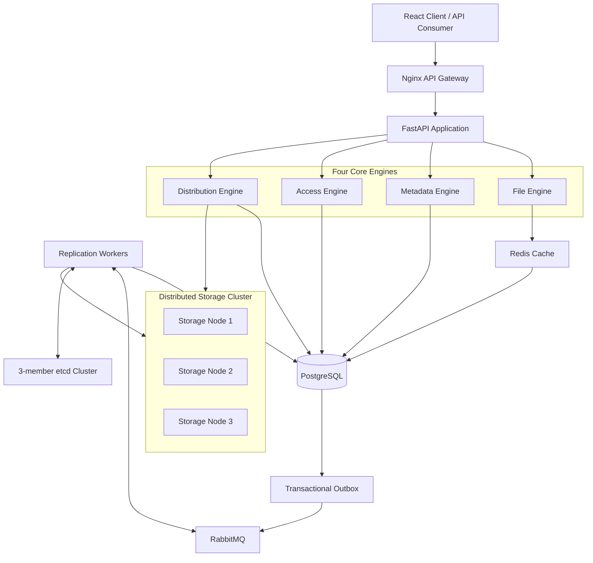

# System Architecture

## Logical layers

## Engine boundaries

| Engine | Owns | Reads/Writes |
|---|---|---|
| File Engine | Upload validation, SHA-256, versions, integrity | Object storage and metadata operations |
| Metadata Engine | File IDs, metadata, versions, replica references | PostgreSQL |
| Access Engine | JWT validation, RBAC, ownership, audit events | PostgreSQL and audit log |
| Distribution Engine | Placement, health, replication, availability | PostgreSQL node registry, storage nodes |
| Replication worker | Durable job execution, verification, repair, reconciliation | PostgreSQL, RabbitMQ, etcd, storage nodes |

## Infrastructure boundaries

- PostgreSQL is authoritative for file metadata, replica records, jobs, and outbox events.
- Redis is a cache and must never be treated as authoritative.
- MinIO or storage-node APIs hold file content only.
- RabbitMQ transports durable background-job notifications; PostgreSQL outbox events
  prevent committed work from being lost during broker outages.
- etcd coordinates leased storage membership and elects one recovery coordinator; it
  is not the metadata database. A three-member cluster needs two members for quorum.
- Nginx routes external traffic and later applies request limits and TLS termination.
