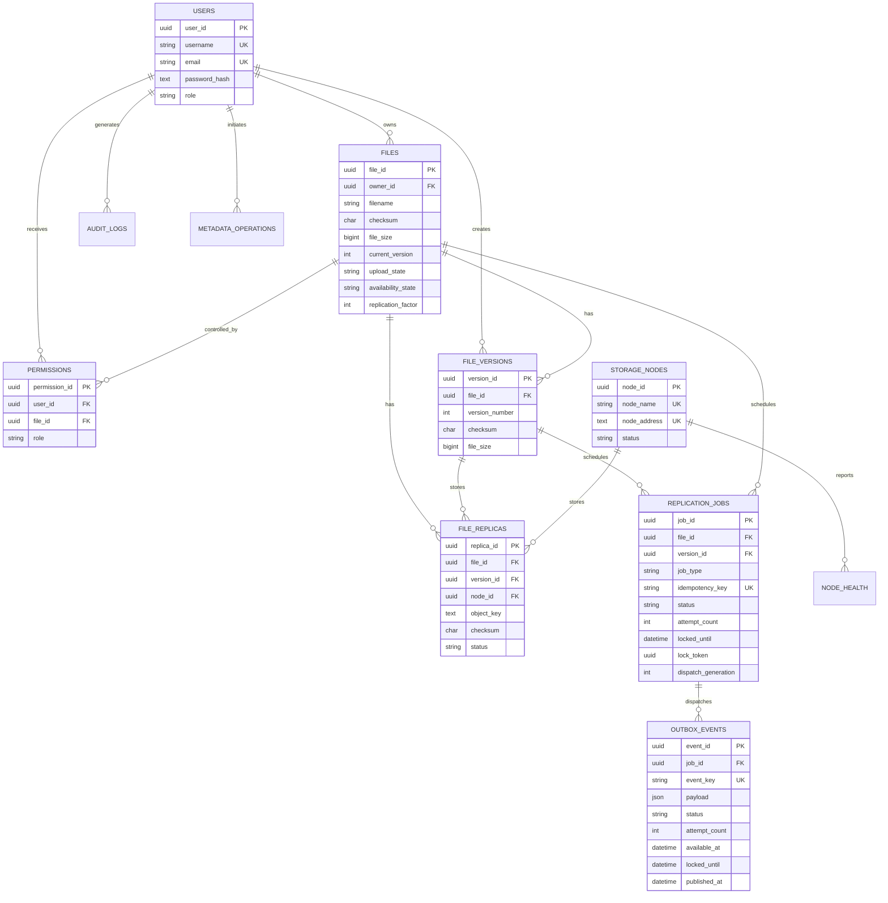

# Database ER Diagram

## Invariants

- File IDs are globally unique UUIDs.
- Version numbers are unique within a file and immutable after commit.
- `checksum` is a lowercase SHA-256 hexadecimal string.
- Replica records identify content independently of user ownership.
- A replica is downloadable only in `VERIFIED` state with a fresh healthy node heartbeat.
- Replica records are unique per file version and storage node.
- Replication jobs are durable, idempotent, leased, fenced, and bounded by a retry limit.
- Job state and its outbox event are committed in the same PostgreSQL transaction.
- Outbox events are published at least once; consumers deduplicate by the PostgreSQL job.
- File-level work leases serialize different job types for the same file.
- Deduplicated content is deleted only after every owner reference is removed.
- Permissions are checked against PostgreSQL even when Redis metadata is present.

Phase 4 and 5 schema changes are applied by Alembic after the baseline `schema.sql`
has initialized a clean PostgreSQL volume. The Phase 5 migration adds typed and
fenced jobs, per-file work leases, and the transactional outbox. Legacy replica
rows are migrated to an unverified state; the worker only backfills legacy objects
after checksum validation.
