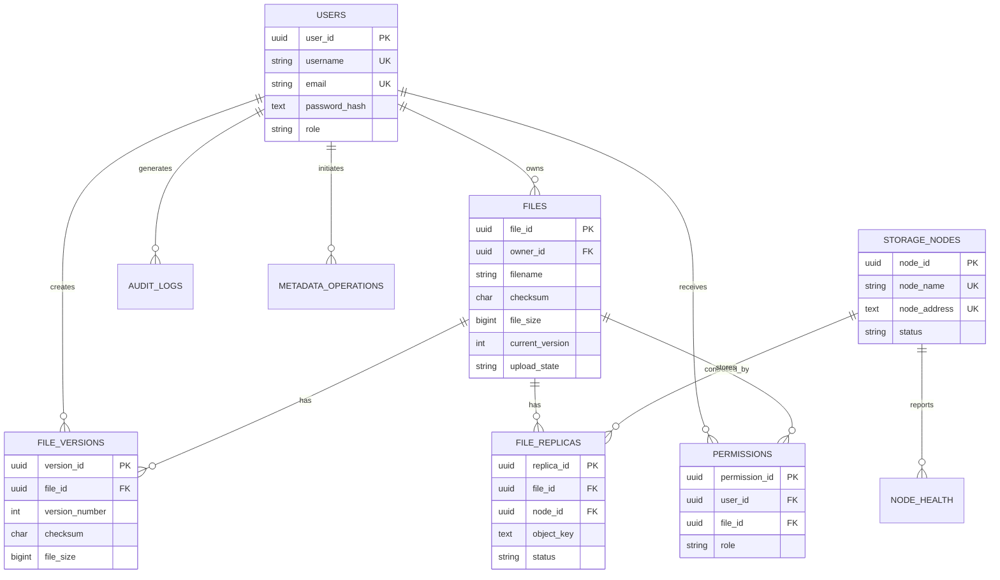

# Database ER Diagram

## Invariants

- File IDs are globally unique UUIDs.
- Version numbers are unique within a file and immutable after commit.
- `checksum` is a lowercase SHA-256 hexadecimal string.
- Replica records identify content independently of user ownership.
- Deduplicated content is deleted only after every owner reference is removed.
- Permissions are checked against PostgreSQL even when Redis metadata is present.
